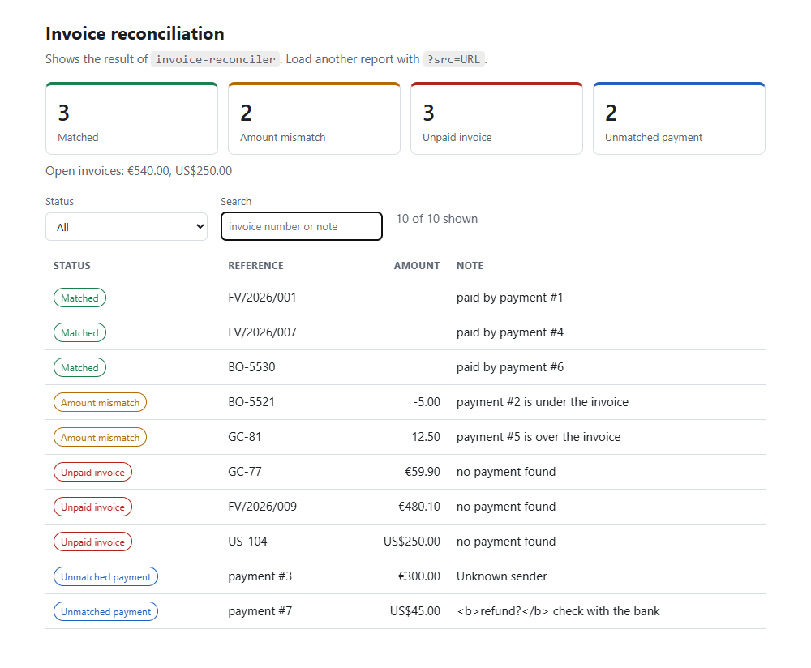

# reconciliation-dashboard

A small browser dashboard for the report produced by [invoice-reconciler](../invoice-reconciler): four summary cards (matched, amount mismatch, unpaid invoice, unmatched payment),
the money still open per currency, and a table you can filter by status and search by invoice number or note.



## Run it

```bash
npm run serve            # python -m http.server 8080, then open http://localhost:8080
```

It loads `data/sample_report.json` by default. Point it at any other report with `?src=URL`, for example the output of the reconciler API:
`http://localhost:8080/?src=http://localhost:8000/reconcile` (the API needs CORS enabled for that, or export the JSON to a file first).

## Design notes

- **Logic and DOM are separate.** `src/report.js` holds pure functions (flatten the report, summarise, filter, format money, validate); `src/app.js` is only DOM glue.
  That is why the logic is covered by Node's built-in test runner without a browser or any dependency.
- **No framework, no build step, no dependencies:** plain ES modules.
- **Report data is never parsed as HTML.** Everything goes through `textContent`, so a payment description such as `<b>refund?</b>` is shown literally (the sample data contains one on purpose).
- **Money is summed in whole cents** to avoid floating-point drift (59.90 + 40.10 is exactly 100.00).
- A broken report or a missing file shows a clear message instead of an empty page.
- Light and dark theme follow the system setting; the table drops its note column on narrow screens.

## Tests

```bash
npm test                 # node --test, 6 tests, no dependencies
```

Covered: flattening, per-status counts, money sums per currency, filters, money formatting with a fallback for unknown currency codes, and report validation.
The page itself was checked in a real browser: cards and counts, status filter, text search, the empty state, the error state and the escaping of markup in the data.

CI: a GitHub Actions workflow (`.github/workflows/tests.yml`) is included; it runs once the repository is on GitHub (it has not been run yet).

## Stack

JavaScript (ES modules), HTML, CSS, Node test runner, Git.

## About this project

Developed with AI coding assistance; the logic is covered by tests and the page was checked in a browser before each commit.
